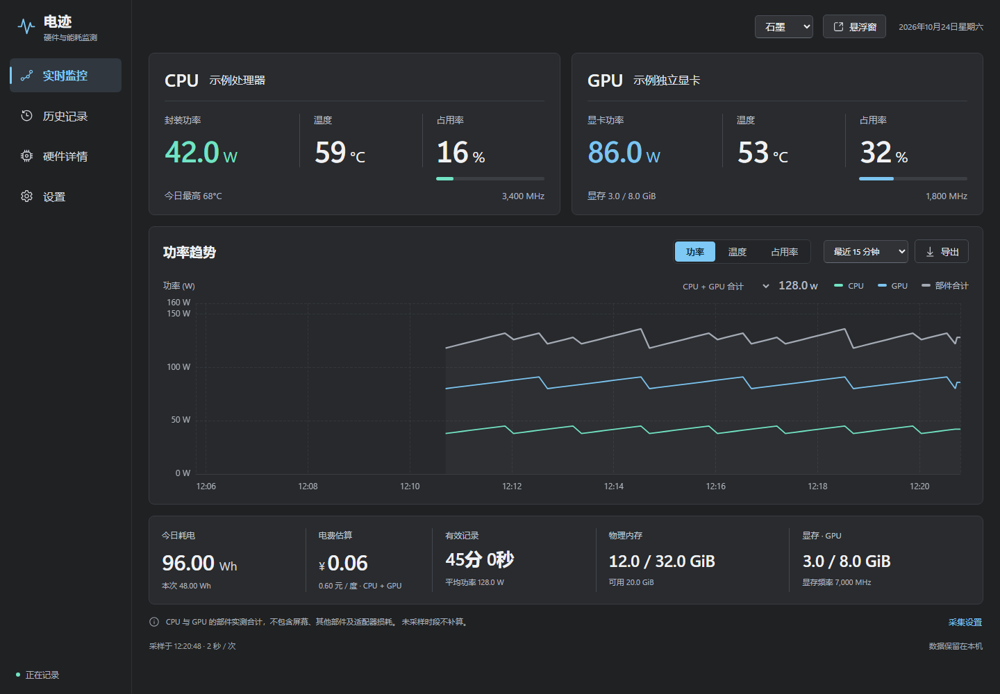
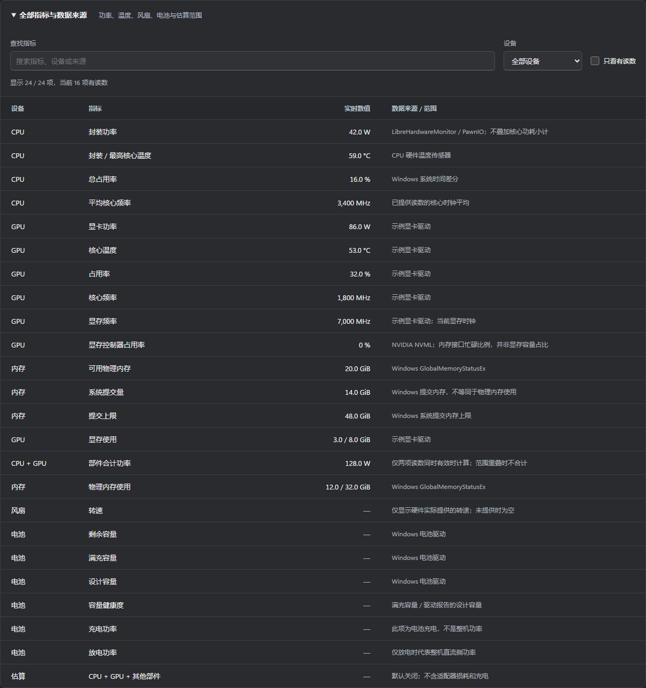

# 电迹 · ElectricTrace

在 Windows 上查看电脑的功耗、温度与耗电趋势。提供桌面悬浮窗和完整统计窗口，读数、设置和历史保存在本机。

[English](README.en.md) · [下载安装](#下载安装) · [兼容范围](docs/COMPATIBILITY.md) · [更新记录](CHANGELOG.md) · [反馈问题](https://github.com/xiaopeng-he/ElectricTrace/issues)

本仓库提供文档和封装安装包，自有源码保持私有。当前 **0.5.0 为预览版**，仍在完善兼容性、长期性能与商业交付流程。

*图片使用示例数据展示界面。实际读数取决于你的硬件、驱动和权限；未提供的指标显示“—”。*

## 下载安装

| 选择 | 下载 | 适合谁 |
| --- | --- | --- |
| **Windows 安装版（推荐）** | [ElectricTrace-0.5.0-Windows-Setup.exe](https://github.com/xiaopeng-he/ElectricTrace/releases/download/v0.5.0/ElectricTrace-0.5.0-Windows-Setup.exe) | 普通使用；按当前用户安装，自动选择 x64 / x86 |
| Windows 便携版 | [ElectricTrace-0.5.0-Windows-Portable.zip](https://github.com/xiaopeng-he/ElectricTrace/releases/download/v0.5.0/ElectricTrace-0.5.0-Windows-Portable.zip) | 希望完整解压后运行，数据保存在软件旁边 |
| 文件校验 | [SHA256SUMS.txt](https://github.com/xiaopeng-he/ElectricTrace/releases/download/v0.5.0/SHA256SUMS.txt) | 核对下载是否完整；校验值不替代发布者签名 |

[查看全部发布资产](https://github.com/xiaopeng-he/ElectricTrace/releases/tag/v0.5.0)

**32 位 Windows 也使用同一个安装器。** 软件内含两套程序并自动选取，不需要猜测。当前没有 macOS / Linux 安装包；Windows ARM 的范围见[兼容说明](docs/COMPATIBILITY.md)。

1. 运行安装器；便携版则完整解压到可写目录，双击 `电迹.exe`，请保留其余文件。
2. 完整界面需要 **.NET Framework 4.8+** 和 **WebView2 Runtime 120+**。缺少 WebView2 时可先使用基本界面；[微软 .NET](https://dotnet.microsoft.com/download/dotnet-framework/net48) / [微软 WebView2](https://developer.microsoft.com/microsoft-edge/webview2/#download-section)。
3. 需要 CPU 温度与封装功耗时，在应用中开启 CPU 增强采集，由你确认 Windows 权限提示。其他可用指标会继续显示。

预览包尚未使用可信证书签名，Windows 可能显示“未知发布者”。请从本仓库 Release 下载并核对校验值，保持系统防护开启。

## 日常使用

- **实时监控**：CPU / GPU 功率、温度、占用率和频率，内存与显存，以及功率、温度和占用率曲线。
- **电量统计**：今日与本次累计、有效记录时间、平均功率、按设置电价估算的费用；按日、周、月或自选日期查看并导出 CSV。
- **硬件详情**：核心读数、功耗分项与电压、24 类指标及来源；按设备和关键词筛选，或只看有读数的项目。
- **桌面悬浮窗**：查看主要数字、置顶与拖动，随时返回完整窗口。
- **本地备份**：运行中保存历史与设置；还原先校验、再确认，旧文件保留在恢复点。

*默认保留全部指标；筛选改变观看方式，不删减原始记录。原始 CPU 传感器按需展开。*

关闭主窗口后会收至托盘并继续采样；从托盘选择“退出”才会结束采集。主窗口隐藏后释放主网页，悬浮窗使用独立轻量页面。

## 读数怎样理解

**CPU + GPU 是部件合计。** 它不包含屏幕、其余部件及适配器损耗。电池放电功率只在实际放电时代表整机直流侧读数；可选整机估算会明确标注。

电量按相邻有效采样积分：`1 kWh = 1000 Wh = 1 度电`。退出、休眠、传感器缺失和记录中断时段不会补算。零值与未知值分开处理；CPU 数据延迟会单独提示，其他可用读数继续显示。

电价默认值仅为示例，请按实际电价修改。费用与选中的统计口径有关，不等同于插座电表账单。

## 硬件与平台

| 环境 | 当前范围 |
| --- | --- |
| Windows 11 x64 | 已有本机真实采集基线；发布程序集与界面另有分层验证 |
| x86 / 32 位 | 发布包含 x86；目前在 Win11 的 WOW64 中验证，32 位实体系统待验证 |
| Windows 10 1709+ | 目标范围，待实体系统验收 |
| Windows 11 ARM | x64 仿真基本指标的实验范围，尚未实体设备验证；CPU 驱动采集不启用 |
| Windows 7 / 8 / XP | 不支持 |
| macOS / Linux | 暂无安装包 |

NVIDIA 优先读取已有驱动的 NVML；其他显卡依赖硬件库提供的可用传感器。CPU 增强采集需要已有兼容 PawnIO 驱动，软件不会静默安装驱动。风扇、功率域、电池等项目是否可读由设备决定；显示“—”时不会当作 0 计入。

## 数据、备份与隐私

- 安装版：`%LOCALAPPDATA%\ElectricTrace\data`；便携版：软件自身的 `data`。界面显示实际位置。
- 在“设置 → 数据与运行”创建 `.etbackup`，包含已保存的历史和设置，采样继续。
- 还原先校验，确认框默认取消；确认后重启，旧历史与设置保留到 `restore-points`。
- 历史、CSV、备份和恢复点未加密，请妥善保管。应用没有账户、云同步或应用内历史上传流程。

更多范围见[隐私说明](docs/PRIVACY.md)。卸载安装版保留数据，便于重新安装后继续使用。

## 版本状态与反馈

当前仍为持续改进的预览版。新界面经过隔离浏览器和指标契约测试；采集、数据保留、故障恢复与受保护程序集分别验证。新版本尚未在所有真实账户、Windows 版本和硬件上完成验收，也未完成实际断电及长期资源认证。

反馈时请说明应用版本、Windows 版本、x64 / x86 / ARM、CPU / GPU 型号及复现步骤。请只提供脱敏错误文字，不上传完整 `data`、历史数据库、备份或 `session.dat`。[提交问题](https://github.com/xiaopeng-he/ElectricTrace/issues/new/choose)。

自有程序保持闭源，第三方组件的许可和源码来源见 [THIRD-PARTY.md](THIRD-PARTY.md) 及安装包 `licenses`。当前未发布自有源码的开源授权；商业授权与支持条款会另行说明。
